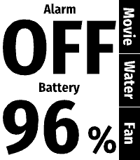
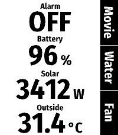

# HA Glance

A Home Assistant dashboard for the Pebble Time 2: up to four values, each drawn
as large as its share of the screen allows, and three buttons that trigger
Home Assistant entities.

There is no settings screen yet. The Home Assistant address, the access token
and the entities are compiled in, so everyone builds their own copy.

 

## What the screen shows

- **Values** are stacked on the left, one to four of them in equal rows. Each
  has a small caption and a reading scaled to fill its row; a unit follows the
  reading at half its size.
- **Buttons** are labelled along the right edge, next to the physical buttons.
  A pressed button turns yellow until Home Assistant has answered, then green
  with a short vibration, or red with a double vibration when the action
  failed or nothing answered within 15 seconds.
- A value that could not be read shows as `?`.
- Values turn grey when the phone has not delivered fresh ones for more than
  75 seconds. Until the first ones arrive the screen says "Loading…", or
  "No phone" when the watch is not connected.

Values are read when the app opens, every 30 seconds while it is open, and one
second after a button did its work.

A button runs scripts and scenes, triggers automations, presses button
entities and toggles everything else.

## Configure

Copy `settings.example.json` to `settings.json`, which git ignores, and adjust
it. It holds the Home Assistant address, the values (at most four) and the
three buttons, top to bottom:

    {
      "url": "https://ha.example.org",
      "values": [{ "label": "Battery", "entity": "sensor.battery" }],
      "buttons": [{ "label": "Movie", "entity": "script.movie_night" }]
    }

A value's `label` may be left out; its reading then takes the whole row.

A value can give states a text of their own with `shown_as`. Short texts are
drawn larger, which is what the alarm states use it for; states it does not
list are shown as they are:

    { "label": "Alarm", "entity": "alarm_control_panel.home",
      "shown_as": { "disarmed": "OFF", "armed_away": "AWAY" } }

The access token is not kept in git. Create a long-lived access token in Home
Assistant (profile, Security tab) and put it in a file named `ha-token` in
this directory:

    echo '<token>' > ha-token

Both are built into the app, so **the built package is a credential**: anyone
holding the `.pbw` can use Home Assistant as you. Keep it off shared storage.

## Build and install

Needs the Pebble SDK: `uv tool install pebble-tool --python 3.13`, then
`pebble sdk install latest`.

    pebble build

Open `build/pebble-ha-glance.pbw` on the phone with the Pebble app to
sideload it.

## Test

    make test            # host tests of the C and JavaScript code, a second
    make test-emulator   # the whole app in the emulator, about 20 seconds

`make test-emulator` runs the real watch binary and phone-side script in a
headless Pebble Time 2 emulator against a stand-in Home Assistant
(`tools/fake_ha.js`) and compares the screen with the pictures in
`test/screens`.

`tools/emu.sh` drives the emulator by hand: install, press buttons, send
messages, take screenshots. It always builds with `dev/settings.json`, which
points at the stand-in, so that buttons pressed in the emulator never reach
the house, and it removes that build afterwards so that it is not sideloaded
by mistake. Run `pebble build` again before installing on the watch.

## How it is built

The watch side (`src/c`) only draws and reports button presses; the phone side
(`src/pkjs`) talks to Home Assistant.

| File | Does |
|---|---|
| `src/c/main.c` | App life cycle, buttons, messages to and from the phone, refresh timer |
| `src/c/draw.c` | Draws the dashboard |
| `src/c/layout.c` | Where values, captions and button labels go |
| `src/c/ink.c` | Measures the area a text's glyphs cover |
| `src/c/fit.c` | Picks the size at which text fills its room; places a unit after its value |
| `src/c/text.c` | Copies UTF-8 text into fixed buffers |
| `src/pkjs/app.js` | Sends the dashboard, triggers buttons |
| `src/pkjs/home_assistant.js` | Home Assistant REST calls |
| `src/pkjs/index.js` | Entry point; `config.json` next to it is written by the build |

Messages (keys in `package.json`): the watch sends `REFRESH` or `PRESS` with a
button number, 0 at the top. The phone sends the dashboard as `VALUE_COUNT`,
`CAPTION[i]`, `VALUE[i]`, `UNIT[i]` and `BUTTON[i]`, and the outcome of a press
as `SUCCEEDED` or `FAILED` with the button number.

### Text

Pebble's system fonts come in a few fixed sizes, so text is drawn as vector
outlines with [pebble-fctx](https://github.com/jrmobley/pebble-fctx), which
scales to any size. It and its helper pebble-utf8 (both MIT) are included as
source under `src/c/vendor`, taken from their repositories at commits
`867f097` and `599c4ec`.

The font, `resources/fonts/text.ffont`, is derived from Fira Sans Condensed
Bold (SIL Open Font License, `resources/fonts/OFL.txt`): `tools/make_font.py`
converts the outlines of Basic Latin, Latin-1 and a few more characters.
`make font` regenerates it from the TrueType font; characters it lacks are not
drawn.

Only the Pebble Time 2 (`emery`) is built. Nothing in the code is tied to its
screen size, but no other watch has been tried.

## Licence

Copyright (C) 2026 Jens Kraemer

This program is free software: you can redistribute it and/or modify it under
the terms of the GNU General Public License as published by the Free Software
Foundation, either version 3 of the License, or (at your option) any later
version. It is distributed in the hope that it will be useful, but WITHOUT ANY
WARRANTY; without even the implied warranty of MERCHANTABILITY or FITNESS FOR
A PARTICULAR PURPOSE. See `LICENSE` for the full text.

Included work of others keeps its own licence: pebble-fctx and pebble-utf8 by
JR Mobley under the MIT licence (`src/c/vendor/*/LICENSE`), and the font
outlines under the SIL Open Font License (`resources/fonts/OFL.txt`).

The screen with readouts on the left and three buttons on the right follows
the idea of the app "home assistant pebble" by Joshua Galea; no code or
artwork of it is used. This project is not affiliated with Home Assistant or
Core Devices.
